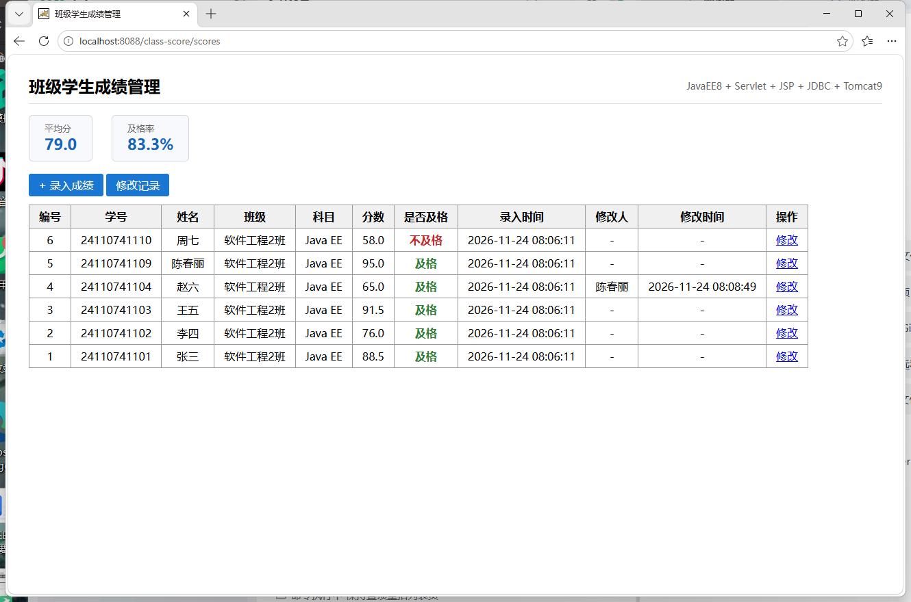
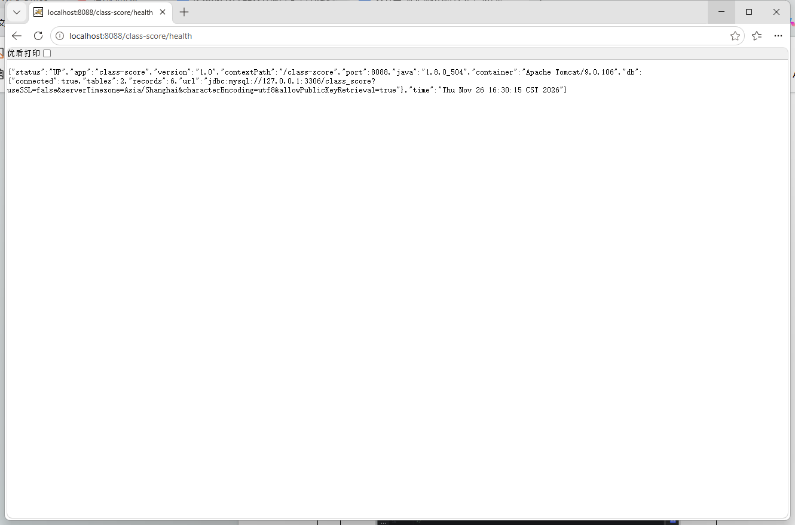

# class-score 班级学生成绩管理系统

基于 **Java EE 8（javax.\*）** 的班级成绩管理小系统，用于演示传统 Servlet + JSP + JDBC 分层开发与 **Tomcat 9 + MySQL 8** 的生产化部署。项目不含框架脚手架，全部代码可在报告中逐行复查。

- 仓库地址：<https://github.com/grade-system/class-score>
- 部署文档：[DEPLOY.md](DEPLOY.md)
- 作者：陈春丽（24110741109，软件工程 2 班）

## 一、技术栈

| 类别 | 选型 | 说明 |
|---|---|---|
| 运行平台 | **Java EE 8（Web Profile）** | 只使用 `javax.servlet.*`，**不使用** `jakarta.*` |
| Web 容器 | **Apache Tomcat 9.0.x** | Servlet 4.0 / JSP 2.3，JavaEE 8 的参考实现容器 |
| JDK | 1.8 | 编译级别 `source/target = 8` |
| 数据库 | **MySQL 8.0** | 驱动 `mysql-connector-java 8.0.30`，InnoDB + utf8mb4 |
| 视图 | JSP 2.3 + JSTL 1.2 | `javax.servlet:jstl:1.2` |
| 数据访问 | JDBC（手写 DAO） | 无 ORM，SQL 全部在 `dao` 层 |
| 构建 | Maven（`maven-war-plugin`） | 产物 `target/class-score.war`，上下文路径 `/class-score` |
| 测试 | JUnit 4.13.2 | 只测不依赖数据库的业务校验与统计 |

> 版本红线：本项目**不得**出现 `jakarta.*` 包名、Tomcat 10+ 配置或 Jakarta EE 依赖。`pom.xml` 中只有 `javax.servlet` 依赖，CI 前的自检命令见第七节。

## 二、核心功能

1. **成绩录入**：学号、姓名、班级、科目、分数（0~100），前端必填 + 后端二次校验。
2. **成绩列表**：按科目精确筛选、按学号/姓名模糊搜索、每页 10 条分页，实时显示记录数、平均分、及格率。
3. **成绩修改（留痕）**：修改必须填写修改人；同一条修改在**同一事务**内更新成绩并写入 `score_change_log`，记录修改前后分数、修改人与时间。
4. **修改记录查询**：按学号过滤最近的修改留痕（默认最近 50 条）。
5. **科目统计**：一条聚合 SQL 输出各科目人数、平均分、最高分、最低分、及格率。
6. **健康检查**：`GET /health` 返回 JSON（200/503），包含数据库连通性、表数量、记录数、版本与构建时间，供部署后一键验证。

### 业务规则（后端强制，前端仅做提示）

| 规则 | 实现位置 |
|---|---|
| 同一学生同一科目只允许一条成绩 | `ScoreRecordService.add()` + `ScoreRecordDao.exists()` |
| 分数必须在 0~100 之间 | `ScoreRecordService.add()/updateScore()` |
| 修改成绩必须填写修改人 | `ScoreRecordService.updateScore()` |
| 修改成绩与写留痕必须同成败 | `ScoreRecordDao.updateWithLog()`（`setAutoCommit(false)` + 回滚） |
| 数据库密码缺失时快速失败并提示修法 | `DBUtil.getConnection()` |

## 三、分层目录结构

```
class-score
├─ pom.xml                       # WAR 打包、finalName=class-score
├─ DEPLOY.md                     # 从零部署手册（含 12 条故障分支）
├─ sql/class_score.sql           # 建库建表 + 最小权限账号 + 初始数据
├─ scripts/
│  ├─ deploy_war.sh              # 复制 WAR、清理旧目录、等解压、调 /health
│  ├─ check_deploy.sh            # 进程/端口/解压/健康/业务页 5 项自检
│  └─ tomcat-setenv.sh.template  # Tomcat 9 环境变量模板（DB_URL/USERNAME/PASSWORD）
└─ src/main
   ├─ java/com/example
   │  ├─ entity/     ScoreRecord、ScoreChangeLog、SubjectStat
   │  ├─ dao/        ScoreRecordDao（全部 SQL 与结果集映射）
   │  ├─ service/    ScoreRecordService（校验、事务编排、统计口径）
   │  ├─ servlet/    ScoreRecordServlet(/scores)、StatsServlet(/stats)、HealthServlet(/health)
   │  ├─ filter/     EncodingFilter（UTF-8）
   │  └─ util/       DBUtil（连接、参数化查询、配置读取）
   ├─ resources/     db.properties（密码留空）、db.properties.template、build.properties
   └─ webapp/        list.jsp、add.jsp、edit.jsp、logs.jsp、stats.jsp、WEB-INF/web.xml
```

## 四、本地开发启动

前置：JDK 8、Maven 3.6+、MySQL 8。

```bash
# 1. 取代码
git clone https://github.com/grade-system/class-score.git
cd class-score

# 2. 初始化数据库（建库、建表、建最小权限账号、插入 6 条示例数据）
mysql -uroot -p < sql/class_score.sql

# 3. 配置数据库密码：不要写进 db.properties，用环境变量
export DB_PASSWORD='Score@2026'      # Windows: set DB_PASSWORD=Score@2026

# 4. 构建
mvn -B clean package                # 产物 target/class-score.war

# 5. 部署到本地 Tomcat 9（示例）
cp target/class-score.war $CATALINA_HOME/webapps/
$CATALINA_HOME/bin/startup.sh       # Windows: %CATALINA_HOME%\bin\startup.bat

# 6. 验证
curl http://localhost:8080/class-score/health
# 浏览器打开 http://localhost:8080/class-score/scores
```

可选环境变量（优先级高于 `db.properties`）：`DB_URL`、`DB_USERNAME`、`DB_PASSWORD`。

## 五、部署方式

完整步骤、部署工件清单与故障分支见 **[DEPLOY.md](DEPLOY.md)**：

- 环境要求：JDK 8 + Tomcat 9 + MySQL 8（Linux 服务器）
- 三步部署：`sql/class_score.sql` → `scripts/tomcat-setenv.sh.template` 配置密码 → `scripts/deploy_war.sh`
- 部署后自检：`scripts/check_deploy.sh`（输出 `PASS=5 FAIL=0` 表示全部通过）
- 故障分支：端口冲突、数据库连接失败、Tomcat 版本不对（Tomcat 10 报 `ClassNotFoundException: javax.servlet.*`）、WAR 未解压、上下文路径错误、root 属主导致解压失败等 12 条

## 六、配对部署验证

本项目已由搭档（GitHub: [@Ting0954](https://github.com/Ting0954)，软件工程 2 班）在 **Ubuntu 22.04 + OpenJDK 8 + Tomcat 9.0.x + MySQL 8.0** 环境中**独立部署成功**（2026-11-26）。

搭档按 `DEPLOY.md` 从 `git clone` 开始，未修改任何源码，完成的操作与结果：

| 步骤 | 搭档执行结果 |
|---|---|
| `mysql < sql/class_score.sql` | 建库成功，`score_record` 与 `score_change_log` 各就绪，6 条初始数据可查 |
| 按 `tomcat-setenv.sh.template` 写入 `bin/setenv.sh` 并重启 Tomcat 9 | 启动日志无异常，`/health` 返回 200 且 `db.connected=true` |
| `./scripts/deploy_war.sh` | 部署成功，脚本自动调用 `/health` 并输出 HTTP 200 |
| `./scripts/check_deploy.sh` | 输出 `PASS=5 FAIL=0` |
| 浏览器访问 `/scores` | 列表正常，筛选、分页、修改成绩与查看留痕均可用 |

**证据**：①搭档部署完成后的访问截图与文字确认（配对群，已附在实验八报告“配对部署证据”一节）；②搭档部署过程中提出的问题（“数据库密码写在哪没看明白”）已转化为 `DEPLOY.md` 第四节与 `tomcat-setenv.sh.template`，见交互记录；③双向部署确认表见实验七报告。

## 七、版本红线自检

```bash
# 必须输出 0
grep -r --include=*.java --include=*.jsp --include=*.xml -c "jakarta\." . | grep -v ':0' | wc -l
# 依赖只应出现 javax.servlet
mvn -B dependency:tree | grep -i servlet
```

## 八、演示截图

| 页面 | 截图 |
|---|---|
| 成绩列表（含筛选、分页、统计卡片） |  |
| 健康检查 JSON |  |

## 九、已知不足

- 课程要求聚焦 Servlet/JSP/JDBC 分层与部署，未实现登录与角色权限，默认按“单一教师”使用；如需扩展，可在 `filter` 层增加会话校验。
- 统计口径为全量学生（不区分学期），多学期场景需要增加 `term` 字段。
